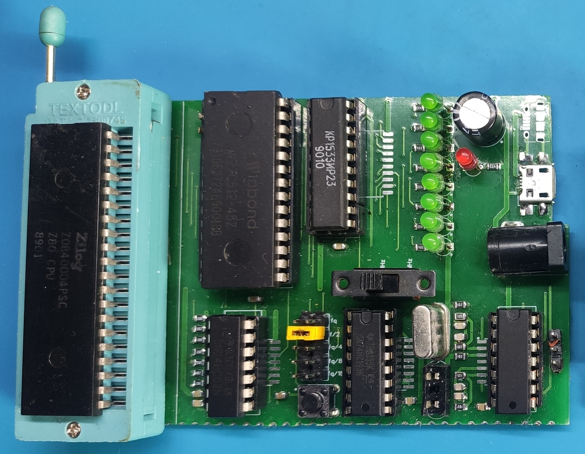
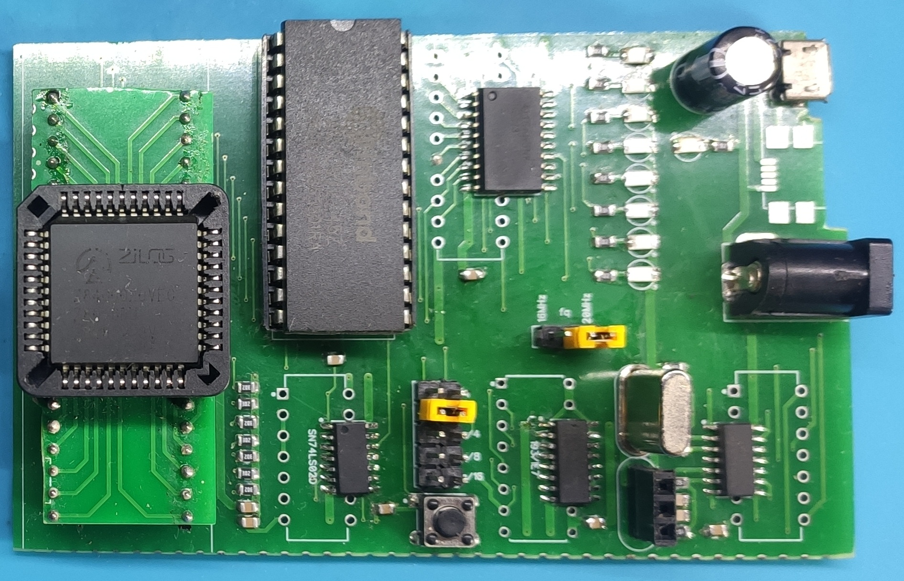

# Z80Tester  
Основан на проектах  
[oshwlab.com/vitalian1980/z80-tester](https://oshwlab.com/vitalian1980/z80-tester)  
https://github.com/djtersteegc/z80-cmos-nmos-tester  
Отличие от этих проектов. Добавлена проверка входов /INT /NMI  
Прошивку можно использовать на других платах  
Компилятор z80 для PC  
https://pasmo.speccy.org/pasmodoc.html  
Версия на DIP Микросхемах  

Версия на SOIC Микросхемах  

